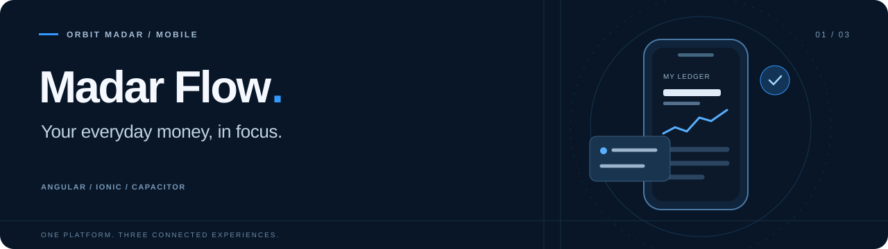

<div align="center">
  

# Madar Flow · Mobile

**A calmer way to manage everyday money.**

The consumer app for Madar Flow by **Orbit Madar**.<br>
Income, expenses, and account activity across browser, PWA, and native mobile.


[Overview](#overview) · [Quick start](#quick-start) · [Configuration](#configuration) · [Native apps](#native-apps) · [Development](#development)

<p dir="rtl">تطبيق مدار فلو لإدارة الدخل والمصروفات، مع العمل دون اتصال، والمزامنة، ودعم العربية والإنجليزية.</p>
</div>

---

## Overview

Madar Flow keeps financial records available when connectivity drops and reconciles queued changes when a connection returns. Its **Calm Personal Ledger** design system brings shared typography, page headers, sheets, and light/dark themes to the consumer experience.

| Capability | What it provides |
| --- | --- |
| Personal ledger | Income and expense records, categories, and transaction history. |
| Offline workflows | Dexie/IndexedDB storage, an account-scoped durable queue, and reconnect processing. |
| Conflict resolution | Keep Mine, Keep Current, and Review & Merge flows for conflicting changes. |
| Authentication | Password and Google sign-in, session handling, and native biometric quick unlock. |
| Notifications | An in-app inbox, read state, preferences, realtime updates, and Android push. |
| Backup and export | Google Drive backup workflows and permission-gated CSV/PDF data export. |
| Personalization | Arabic RTL and English LTR, themes, app settings, and optional device auto-lock. |
| Subscriptions | Plan and permission presentation, with native store-purchase integration. |

### Part of one platform

| Repository | Responsibility |
| --- | --- |
| **Madar-Flow-Mobile** · this repository | Consumer experience, offline data, synchronization UI, and native integrations. |
| [Madar-Flow-Admin](https://github.com/Soliman-Shahin/Madar-Flow-Admin) | Administration, analytics, permissions, and operational workflows. |
| [Madar-Flow-BE](https://github.com/Soliman-Shahin/Madar-Flow-BE) | REST API, persistence, authentication, synchronization, and delivery. |

Each repository has its own dependencies and build. There is no shared root install.

## Quick start

Use **Node.js 22.12+ within the 22.x release line**, npm, and a running Madar Flow backend. Native builds need the corresponding platform toolchain as well.

```sh
git clone https://github.com/Soliman-Shahin/Madar-Flow-Mobile.git
cd Madar-Flow-Mobile
npm ci
npm start
```

Open **[http://localhost:4400](http://localhost:4400)**. The development server reloads on source changes.

For browser development, `/api/v1` is proxied to `http://localhost:3000/v1` through [proxy.conf.js](proxy.conf.js). Start the backend separately; `npm start` launches only this frontend.

## Configuration

Angular selects configuration from [src/environments/](src/environments). Browser and native networking have separate settings:

| Setting | Purpose |
| --- | --- |
| `browserApiUrl` | Browser REST base path; development uses `/api/v1`. |
| `nativeApiUrl` | Absolute API URL used by the native app. |
| `backendOrigin` | Backend origin used by origin-based integrations. |
| `apiUrl` | Legacy compatibility field; prefer the explicit settings above for new code. |
| `MADAR_FLOW_API_TARGET` | Development proxy target override, read by `proxy.conf.js`. |

When using a physical device, set a backend address the device can reach. Device `localhost` refers to the device itself. The browser development proxy does not run inside a packaged native app.

| Build | Command | Environment |
| --- | --- | --- |
| Development server | `npm start` | `environment.ts` |
| Staging bundle | `npm run build` or `npm run build:staging` | `environment.staging.ts` |
| Production bundle | `npm run build:prod` | `environment.prod.ts` |

**The default build is staging.** Production builds run [assert-production-env.cjs](scripts/assert-production-env.cjs) first. The checked-in production API host is a placeholder and must be configured for the intended deployment before that build can pass.

Frontend environment values are included in the app bundle. Keep server credentials and service-account material on the backend.

## Native apps

[capacitor.config.ts](capacitor.config.ts) defines the application identity as `com.orbitmadar.madarflow` and uses `www/` for web assets.

### Android

Install Android Studio, the Android SDK, and a JDK compatible with the checked-in Gradle project. Build the web assets for the intended environment before synchronizing:

```sh
npm run build:staging
npm run sync:android
npx cap open android
```

Use `npm run build:prod` instead for a configured production build. For an existing debug installation, `adb install -r <path-to-apk>` preserves app data; uninstalling removes local records, settings, and session state. Keep machine-specific `android/local.properties` out of commits.

### iOS

The repository includes an iOS target. Building it requires macOS, Xcode, and the configured signing and provider setup:

```sh
npm run build:staging
npm run sync:ios
npx cap open ios
```

### Platform coverage

| Platform | Current boundary |
| --- | --- |
| Browser / PWA | Consumer UI, offline storage, synchronization, and realtime inbox updates. Browser push registration is not established. |
| Android | Native push registration, foreground local notifications, background delivery, and notification-tap handling are implemented. |
| iOS | Native project exists; the complete push registration/delivery path still needs platform-specific implementation and verification. |

See [Android push notifications](docs/push-notifications.md) for the delivery flow and troubleshooting details. Platform availability does not imply store publication.

## Development

### Commands

Run these from this repository:

| Command | Purpose |
| --- | --- |
| `npm start` | Serve the development app on port `4400`. |
| `npm run build` | Build the staging web bundle into `www/`. |
| `npm run build:prod` | Validate production configuration and build into `www/`. |
| `npm test` | Run the Jasmine/Karma unit suite. |
| `npm test -- --watch=false --browsers=ChromeHeadless` | Run the suite once with headless Chrome. |
| `npm run lint` | Run Angular ESLint. |
| `npm run sync:android` / `npm run sync:ios` | Synchronize existing web assets and native dependencies. |
| `npm run resources` | Generate Capacitor image assets. |

Karma needs Chrome or Chromium. Native synchronization is needed after relevant plugin/configuration changes and to copy a new web build; ordinary browser development uses `npm start` directly.

### Source map

```text
src/
├── app/
│   ├── core/        # Auth, API, storage, sync, guards, and native services
│   ├── modules/     # Auth, transactions, categories, profile, and settings
│   ├── home/        # Public entry experience
│   ├── layout/      # Application layout
│   └── shared/      # Reusable components and models
├── assets/          # Translations and static assets
├── environments/    # Browser/native API and build configuration
└── theme/           # Ionic theme and Calm Personal Ledger tokens
android/             # Native Android project
ios/                 # Native iOS project
```

Shared visual primitives live in [src/theme/](src/theme), including `_ledger-tokens.scss`, `_page-header.scss`, `_ledger.scss`, and `_sheets.scss`. Reuse these when extending screens.

### Change checklist

- Preserve offline records, account scoping, queue persistence, and conflict handling.
- Guard native APIs with Capacitor platform checks.
- Check affected screens in Arabic/English and light/dark themes.
- Run the relevant checks and `git diff --check` before review.

For bugs, include the platform, build configuration, reproduction steps, and sanitized logs in a [repository issue](https://github.com/Soliman-Shahin/Madar-Flow-Mobile/issues).

---

<div align="center"><strong>Madar Flow</strong> by Orbit Madar<br><sub>Everyday money. A clearer perspective.</sub></div>
